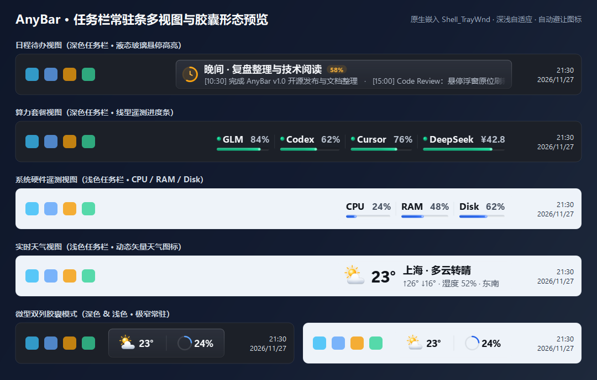
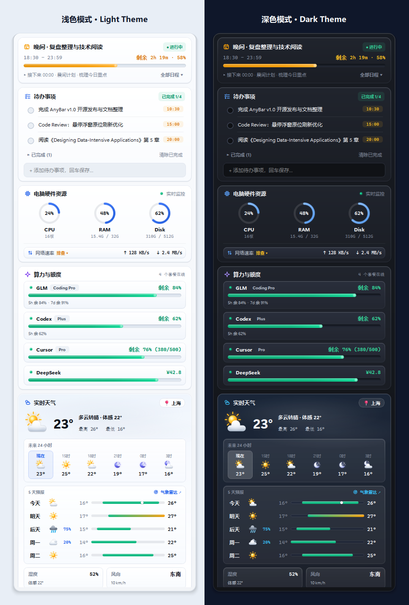
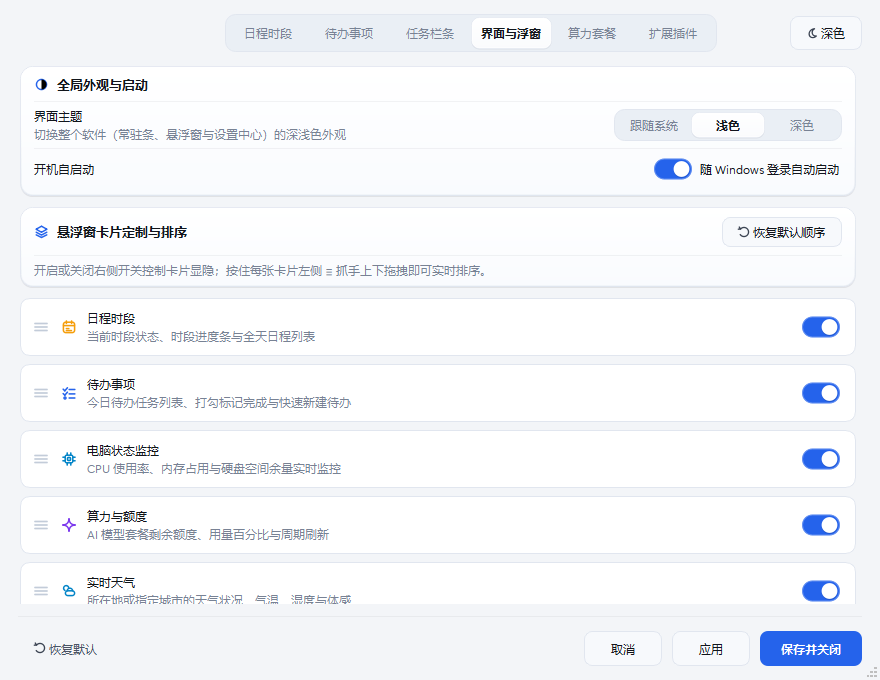
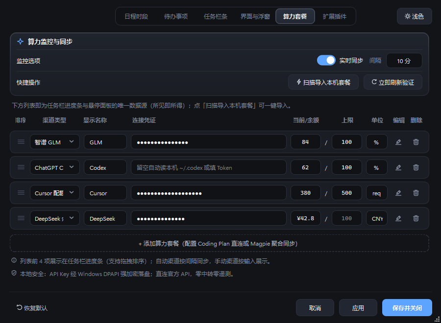
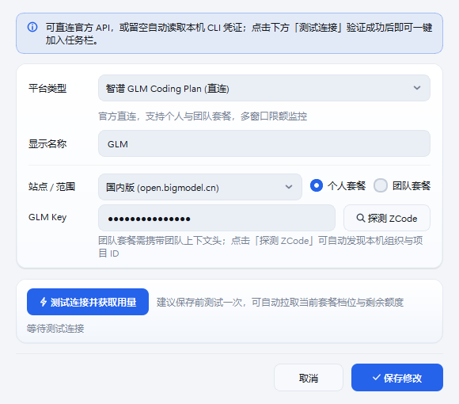

# AnyBar（万能常驻条）· Windows 10 / 11 任务栏常驻看板

在 Windows 10 / 11 任务栏直接嵌入一个原生态 Liquid Fluent 风格常驻条，集成**日程时段提醒、待办跑马灯、AI 算力套餐监控、系统硬件遥测、实时天气预报、Git 仓库状态**与**可定制悬停浮窗**，让日常节奏、待办与核心指标抬眼可见。

> **平台要求**：仅支持 **Windows 10 / 11**（基于 Win32 `Shell_TrayWnd` 窗口嵌入与原生 UI Automation 避让探测）。

---

## 界面预览

### 1. 任务栏常驻条（多视图切换 & 微型双列胶囊）



### 2. 悬停浮窗面板（浅色 / 深色双主题）



### 3. 设置中心与算力配置向导

<details open>
<summary><strong>展开 / 收起设置中心预览（界面与浮窗定制 · 算力套餐管理 · Coding Plan 向导）</strong></summary>

<br/>

**界面与浮窗（全局深浅主题、开机自启与悬浮窗卡片拖拽排序）**



**算力套餐（多平台实时监控、本机凭据一键扫描与拖拽排序）**



**Coding Plan 算力配置向导（直连测试与自动拉取套餐窗口）**

<p align="center">
  
</p>

</details>

---

## 核心特性

- **原生任务栏嵌入与智能避让**：通过本进程 `AnyBarHostWnd` 中转窗口挂载进 `Shell_TrayWnd`，配合原生 C++ UIA 动态库（`taskbar_native.dll`）自动探测托盘与任务栏图标边界，避免遮挡图标与被 z 序压制。
- **多视图一键切换 & 微型双列胶囊模式**：
  - **日程待办视图**：进度环 + 当前时段提醒 + 下行待办跑马灯滚动；
  - **算力套餐视图**：支持智谱 GLM Coding Plan（个人/团队）、ChatGPT Codex、Claude、Cursor、DeepSeek、OpenAI、Kimi、OpenRouter、NewAPI 及本地 Magpie 聚合网关，以线型进度条实时展示剩余额度；
  - **系统硬件视图**：实时监控 CPU / 内存 / 磁盘占用与上下行网速；
  - **实时天气视图**：动态自绘矢量天气图标 + 温度/湿度/风向与逐小时/多日预报；
  - **双列胶囊模式**：极窄常驻（~128px），左右槽位可自由组合天气/CPU/内存/算力/网速/Git 状态。
- **模块化悬停浮窗**：鼠标悬停平滑展开，包含日程、待办（支持勾选完成与回车新增）、系统状态、算力套餐、天气预报、Git 状态等独立卡片，支持在设置中自由拖拽排序与开关显隐。
- **本地隐私与安全**：全部直连官方 API，零中转零遥测；保存在本地 `data/config.json` 中的 API Key 经 Windows DPAPI 强加密落盘。
- **开放插件扩展**：支持在 `%APPDATA%/AnyBar/plugins/` 编写单文件 Python 脚本，使用 `@register` 注册自定义数据源（详见 [CONTRIBUTING.md](CONTRIBUTING.md)）。
- **系统集成细节**：深浅主题自动跟随/一键切换、Per-Monitor DPI V2 缩放、全屏应用（视频/游戏）自动隐藏、单实例互斥与开机自启。

---

## 快速开始

### 方式一：下载 Release 可执行文件（推荐）

前往 [Releases](../../releases) 下载最新的 `AnyBar.exe`，双击即可运行，无需安装 Python。首次运行会在同级 `data/config.json` 自动生成默认配置。

### 方式二：从源码运行（开发者）

```bash
# 1. 准备 Python 3.13+ 虚拟环境（示例使用 conda）
conda create -n anybar python=3.13 -y
conda activate anybar

# 2. 安装运行依赖
pip install -r requirements.txt

# 3. 启动
python main.py
```

如需参考完整配置结构，可查看脱敏模板 [data/config.example.json](data/config.example.json)（真实运行配置保存在本地 `data/config.json`，已在 `.gitignore` 中忽略）。

---

## 工程架构（四层分层）

项目遵循高内聚、低耦合的单向分层架构（由 [tests/test_architecture.py](tests/test_architecture.py) 自动校验）：

```text
.
├── main.py                           # 入口：DPI 感知、单实例互斥体、生命周期绑定
├── requirements.txt                  # 运行依赖（PySide6、psutil）
├── build.spec / build.bat            # PyInstaller 单文件打包配置与脚本
├── data/config.example.json          # 脱敏默认配置模板（运行态生成 data/config.json）
├── tests/                            # pytest 单元测试与架构守卫测试
├── scripts/smoke.py                  # 离屏冒烟与内存防泄漏校验脚本
└── app/
    ├── __init__.py                   # 插件兼容别名（app.sources / app.tiles 单例映射）
    ├── core/                         # 核心领域层（无 QtWidgets 依赖）
    │   ├── config.py                 # 配置读写/迁移/DPAPI 加密与时段调度计算
    │   ├── tiles.py                  # Tile 统一数据协议
    │   ├── quota_api.py              # 多平台 AI 算力查询引擎
    │   ├── source_service.py         # 后台数据源调度器
    │   └── sources/                  # 内置数据源与用户插件热加载注册表
    ├── platform/                     # Windows 平台底层互操作层
    │   ├── win32_utils.py            # 任务栏嵌入、全屏检测、WinEvent 钩子与 UIA 调用
    │   ├── glass.py                  # 标题栏深浅色同步与窗口材质
    │   ├── autostart.py              # Windows 注册表开机自启
    │   └── native/taskbar_uia.cpp    # 原生 UIA 探测 C++ 源码（编译为 taskbar_native.dll）
    ├── styles/                       # 设计令牌与独立 QSS 编译引擎
    │   ├── tokens.py / theme.py      # 深浅色语义令牌、字体栈与 DPI 换算
    │   ├── qss_engine.py             # {{token}} / {{px:N}} 模板编译缓存与属性驱动
    │   ├── icons.py / weather_glyph.py
    │   └── qss/                      # 6 份外部纯选择器 QSS 样式表
    └── gui/                          # 表现层
        ├── widgets/                  # 通用控件库（ToggleSwitch、滑块导航、动效与拖拽排序）
        ├── taskbar/                  # 任务栏常驻条（窗口/控件/菜单建造者/多视图策略注册表）
        ├── hover_panel/              # 悬停浮窗（壳层 + 卡片注册表 + 7 张独立卡片）
        └── settings/                 # 设置中心（Mediator 壳层 + 6 个独立页面 + 算力向导）
```

---

## 测试与构建

### 运行测试与防泄漏冒烟

```bash
pip install pytest
python -m pytest tests/ -q
python scripts/smoke.py
```

### 打包为单文件 EXE

```bash
pip install pyinstaller
python -m PyInstaller build.spec --noconfirm
```

产物输出至 `dist/AnyBar.exe`。也可直接双击根目录 [build.bat](build.bat)（自动识别当前激活的 Conda/Venv 环境，或通过 `ANYBAR_PYTHON` 环境变量指定 Python 路径）。

### 可选：从源码重新编译 `taskbar_native.dll`

若需自行审查并重新编译任务栏 UIA 原生探测库，可在 Visual Studio x64 Native Tools Command Prompt 中执行：

```bat
cl /LD /O2 /EHsc app\platform\native\taskbar_uia.cpp /Fe:app\platform\taskbar_native.dll ole32.lib oleaut32.lib user32.lib
```

若 DLL 不存在，程序会自动降级到内置 PowerShell UIA 探测兜底。

---

## 调试日志

运行日志默认写入 `%TEMP%\anybar\`（单文件 1MB 轮转），可通过环境变量自定义：

```bat
set TOUCHBAR_LOG_DIR=C:\Temp\anybar_logs
set TOUCHBAR_LOG_LEVEL=DEBUG
python main.py
```

---

## 开源协议与致谢

- **作者**：[lyroom](https://github.com/lyroom) & Gemini
- **开源协议**：本项目源码采用 [MIT License](LICENSE) 开源；
- **第三方依赖**：许可声明详见 [THIRD_PARTY_LICENSES.md](THIRD_PARTY_LICENSES.md)（包含 PySide6 `LGPL-3.0` 与 psutil `BSD-3-Clause` 说明）。
